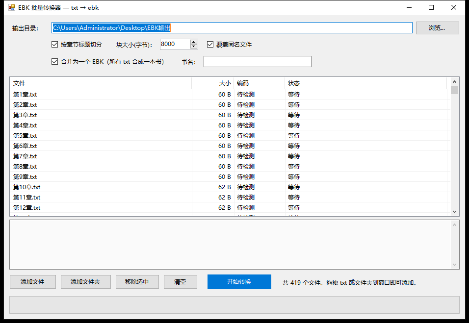

# EBK 工具箱（EBK Creative 格式逆向 + 快速转换）

2005 年的 VB6 程序 **EBK Creative 1.05** 可以把 txt/html 做成文曲星（WQX）用的 `.ebk` 电子书。
本项目逆向出了它的 `.ebk` 文件格式，并重写了一个**更快、可批量、可脚本化**的转换核心，
可以把一堆 txt 合并成**一本多章节的书**，附带一个 Windows 图形界面。

> 已用真实文件校验：用本工具重建 `samples/asd.ebk`，输出 **261,016 字节逐字节完全相同**。

---

## 目录结构

```
abcd/
├─ bin/EbkPacker.exe        图形界面（双击即用，无需安装）
├─ src/EbkPacker.cs         GUI 源码（C# WinForms）
├─ src/ebk_tool.py          Python 核心（命令行 / 可当库用）
├─ src/build.bat            重新编译 GUI
├─ samples/                 示例：demo.txt / demo.ebk / asd.ebk（真实样本）
├─ docs/                    界面截图、EBK 格式与反编译说明
└─ original/                原版 EBK Creative（仅作参考，版权归原作者）
```

---

## 怎么用

### 方式 1：图形界面（推荐，普通用户）

1. 双击 `bin/EbkPacker.exe`；
2. 把 `.txt` 文件（可多个）或整个文件夹**拖进窗口**；
3. 选择输出目录（默认 `桌面\EBK输出`）；
4. 需要多章合并时保持“合并为一个 EBK”勾选，并填“书名”（留空则用文件夹名）；
5. 点“开始转换”。

**默认把列表里所有 txt 合并成一本** `.ebk`（每个 txt 一章）；取消勾选“合并为一个 EBK”，
则每个 txt 各生成一个 `.ebk`。

- 自动识别 **UTF-8 / UTF-16 LE / UTF-16 BE / GBK / GB18030**，非 GBK 的自动转成 GBK；
- 自动按 `第N章 / 第N节 / 第N回 / 第N卷 / 第N篇` 切分，没有标题时用文件名当章节名；
- 一章 ≤255 章直接放根目录；超过 255 章自动分“第1部分 / 第2部分 …”（两级目录）；
- 列表按**自然顺序**排序（第2章 → 第10章 → 第100章），合并顺序与列表一致；
- 转换在后台线程进行，界面不卡。

> 一个 `.ebk` 就是一本书，可以包含多个章节；原版程序左侧树里会列出这些章节。
> 已用原版 EBK Creative 实测：3 章的 `demo.ebk` 和 419 章的合并文件都能正常打开、
> 显示目录树和正文。



### 方式 2：命令行（Python，适合批处理/二次开发）

需要 Python 3.8+，无第三方依赖：

```bash
python src/ebk_tool.py build book.txt -o book.ebk      # txt -> ebk
python src/ebk_tool.py build page.html -o page.ebk --html
python src/ebk_tool.py dump  book.ebk                  # 查看结构（支持嵌套目录）
python src/ebk_tool.py check book.ebk                  # 校验
python src/ebk_tool.py bench book.txt                  # 测速
```

### 方式 3：命令行（exe）

```bat
EbkPacker.exe --cli in.txt out.ebk
EbkPacker.exe --merge out.ebk a.txt b.txt c.txt
EbkPacker.exe --mergedir out.ebk D:\书\某本书
EbkPacker.exe --batch outdir a.txt b.txt c.txt
EbkPacker.exe --open D:\书\某本书
```

`--merge/--mergedir` 把多个 txt 合并成一本；`--batch` 每个 txt 各生成一个，结果写入
`outdir\_ebk_batch.log`；退出码 0 全部成功、2 有失败。

---

## 从源码构建 GUI

只需要 Windows 自带的 .NET Framework 4.x（Win10/11 自带，不用装 SDK）：

```bat
cd src
build.bat
```

或手动：

```bat
%WINDIR%\Microsoft.NET\Framework64\v4.0.30319\csc.exe /target:winexe ^
  /out:..\bin\EbkPacker.exe /r:System.Windows.Forms.dll /r:System.Drawing.dll EbkPacker.cs
```

---

## EBK 格式（简述）

```
文件头 15B:  00 00 00 | (最后一条记录地址-1) u24 | 00 00 00 00 | 正文长度 u24 | 第一条记录地址 u16
目录:        count u8 | parent u16 | 记录地址[count] u16 | 名称 + 0xFF ...
页记录 14B:  00 | parent u16 | x u8 | start u24 | index u16 | end u24 | index u16
索引表 9B:   00 | start u24 | end u24 | 00 00
正文:        所有条目按顺序连续存放（GBK），文件尾 = 最后一页 end
```

更完整的字段说明、逆向过程、性能分析见 **[docs/EBK格式与反编译说明.md](docs/EBK格式与反编译说明.md)**。

---

## 校验结果

| 项目 | 结果 |
|---|---|
| 真实样本 `samples/asd.ebk` 重建 | 261,016 字节逐字节相同 |
| 同一文本存为 UTF-8 / GBK / UTF-16 后转换 | 输出 EBK 完全一致 |
| GUI 与 Python 核心输出 | 逐字节相同 |
| 生成的 3 章 `demo.ebk` 用原版程序打开 | 目录树 3 章、正文正常 |
| 生成的 419 章合并文件用原版程序打开 | `第1部分 → 第1章…`、正文正常 |

原版程序验证截图：`docs/验证-原版打开demo.png`、`docs/验证-原版打开419章.png`。

---

## 关于原版程序（original/）

`original/EBKCreative.exe` 是 2005 年的原版 **EBK Creative 1.05**（VB6 编写），
本项目的 `.ebk` 格式就是通过逆向它得到的，**本项目没有修改原程序**。

- 想直接用原版：双击 `original/EBKCreative.exe`（需同目录的 `ebkcreative.chm`），
  导入 txt/html 后生成 `.ebk`。
- 版权归原作者（MrBlackOx / TG）所有，**仅作格式研究与兼容性参考**，请勿商用分发。
- 本项目与原作者无关。

---

## 已知限制

- EBK 正文编码为 GBK，GBK 无法表示的字符会写成 `?`；
- 单层目录最多 255 章，超过会自动分成“第1部分 / 第2部分 …”（两级目录）；
- 暂不支持图片、封面、`.men` 菜单和 CHM 输入；
- 原版的章节/标题切分规则未 1:1 复刻（本项目按“第N章…”识别）。

---

## 许可

本仓库自有代码采用 **MIT License**（见 [LICENSE](LICENSE)）。
`original/` 下的原版程序不在 MIT 范围内，版权归原作者所有。

## 参考

- [EBK 1.05 文件结构说明（cbflabs，PDF）](http://www.cbflabs.com/downsite/cjbook/downfile/ebkstru105b3.pdf)
- [易码技术论坛：EBK 文件结构讨论](https://www.emsky.net/bbs/forum.php?mod=viewthread&tid=27363)
- [VB6 文件格式规范（sandsprite）](https://sandsprite.com/vbdec/VB6_FileFormat_Spec.html)
