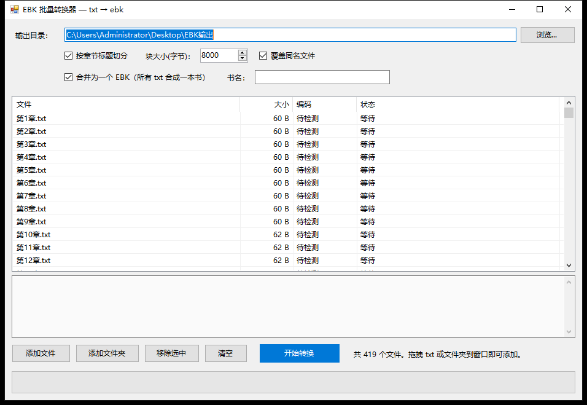

# EBK 批量转换器（GUI）

`EbkPacker.exe` — 单文件绿色程序（.NET Framework 4.x，Windows 10 自带，无需安装）。
支持两种模式：

- **合并为一本书**（默认）：把所有 txt 合并成一个 `.ebk`，每个 txt 一章；
- **每个 txt 一个 EBK**：取消勾选“合并为一个 EBK”即可。

编码自动识别（UTF-8 / UTF-16 / GBK / GB18030），输出目录可指定。



## 用法

1. 双击 `EbkPacker.exe`；
2. **输出目录**默认是桌面上的 `EBK输出`，可点“浏览...”改；
3. 把 `.txt` 文件或整个文件夹**拖进窗口**（也可用“添加文件 / 添加文件夹”）；
4. 需要多章合并时保持“合并为一个 EBK”勾选，并在“书名”里填书名（留空则用文件夹名）；
5. 点“开始转换”。

列表按**自然顺序**排序（第2章 → 第10章 → 第100章），合并时按这个顺序生成章节。

## 关于“一本书多章节”

一个 `.ebk` 就是一本书，可以包含多个章节，原版程序左侧树里会列出这些章节。

- 章节 ≤ 255：所有章节直接挂在根目录（原版树里就是 `Treeview → 第1章、第2章…`）；
- 章节 > 255：自动按 255 章一组分成“第1部分 / 第2部分 …”（原版树里是两级目录）。

已用原版 EBK Creative 实测：
- 3 章合并的 `demo.ebk`：树正常、选中章节正文正常；
- 419 章合并文件：树显示 `第1部分 → 第1章…`，选中后正文正常。

## 功能

- **批量**：支持多选文件、整个文件夹（递归查找 `*.txt`）、拖拽添加；自然排序。
- **自动识别编码**：UTF-8（含 BOM）/ UTF-16 LE / UTF-16 BE / GBK / GB18030；
  非 GBK 的一律转成 GBK 再写入 EBK。实测同一段文本分别存成 UTF-8、GBK、UTF-16，
  生成的 EBK **字节完全相同**。
- **指定输出目录**：默认 `桌面\EBK输出`，可随时修改；同名文件默认覆盖（可取消勾选，
  自动改名为 `xxx_1.ebk`）。
- **按章节切分**：自动识别 `第N章 / 第N节 / 第N回 / 第N卷 / 第N篇` 标题；
  没有标题时按“块大小”切分（默认 8000 字节）。
- **后台转换**：转换在后台线程进行，界面不卡；有进度条和逐文件日志。

## 命令行（可选，便于批处理/自动化）

```bat
:: 单文件
EbkPacker.exe --cli input.txt output.ebk

:: 把多个 txt 合并成一本书
EbkPacker.exe --merge out.ebk a.txt b.txt c.txt

:: 把整个文件夹合并成一本书
EbkPacker.exe --mergedir out.ebk D:\书\某本书

:: 每个 txt 各生成一个 ebk（结果写入 outdir\_ebk_batch.log）
EbkPacker.exe --batch outdir a.txt b.txt c.txt

:: 打开时直接加载文件夹（方便测试）
EbkPacker.exe --open D:\书\某本书
```

退出码：0 全部成功；2 有失败；1 参数/环境错误。

## 校验

- 用 `out\demo.txt`（三章）生成 `demo.ebk`，与 Python 版核心输出**逐字节相同**；
- UTF-8 / GBK / UTF-16 三种输入生成的 EBK **完全一致**；
- 用真实样本 `samples\asd.ebk` 验证过：重建后 261,016 字节完全相同；
- 生成的多章节 EBK 已在**原版 EBK Creative** 中打开验证，树与正文均正常。

## 说明 / 限制

- EBK 正文编码为 GBK；GBK 无法表示的字符会写成 `?`。
- 单层目录最多 255 章，超过会自动分“第N部分”（两级目录）。
- 暂不支持图片、封面、`.men` 菜单和 CHM 输入。
- 合并模式的书名留空时取第一个文件所在文件夹名。
